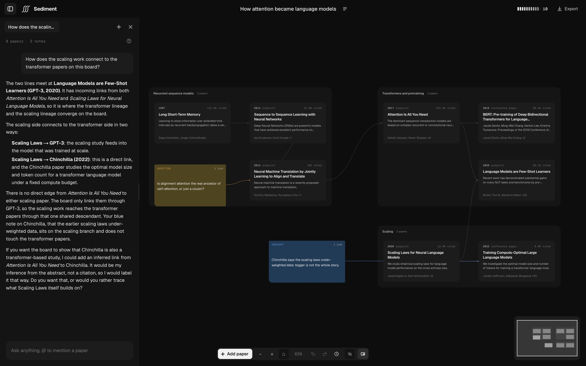

<div align="center">

# Sediment

**A canvas for research.**

Find papers, lay them out, and build up a picture of a field with an AI agent working beside you.

[**Try it → sediment-ai.com**](https://www.sediment-ai.com/)

<a href="https://www.sediment-ai.com/"></a>

</div>

---

Sediment turns literature review into an infinite spatial canvas. Search OpenAlex, map paper lineages, and synthesize connections with an agent working directly on your board.

## What you can do

- **Start from a question.** Type what you are working on. The agent asks what you are after and adds papers one conversation at a time, instead of dumping a graph nobody asked for.
- **Lay it out your way.** Drag papers anywhere, group them into named clusters, and leave unrelated work as its own island. You are the one who connects them.
- **Keep your thinking next to the papers.** Notes, questions, todos and contradictions sit on the canvas and link to the papers they are about. Attach PDFs, images and spreadsheets as file notes.
- **Ask about anything on the board.** Tag papers with `@`, ask how they relate, what one builds on, or what cites it. The agent answers from real OpenAlex data and changes the canvas as it goes.
- **Follow new research.** A feed of new papers for your interests, from arXiv, bioRxiv, medRxiv, journals and more. Mark the ones you like, ask the feed assistant about them, and turn them into a workspace in one click.
- **Never lose your place.** Undo and redo every change, several chats per canvas, a minimap, workspaces you can sort into categories, and export to Markdown.

## How it works

Paper data comes from [OpenAlex](https://openalex.org), the open catalogue of scholarly work. The agent walks the citation graph for you, following references back and citations forward across several hops, then puts what it finds on your canvas: real papers only, with links it infers kept apart from verified citations.

Read more in [docs/architecture.md](docs/architecture.md).

## Run it yourself

Sediment is a Next.js frontend and a FastAPI backend, with Supabase for storage.

First put your Anthropic key, Supabase project and an `ACTOR_KEY_SECRET` (`openssl rand -hex 32`) in `backend/.env`; [docs/development.md](docs/development.md) lists every variable. Then, from the repository root:

```bash
# terminal 1: backend
cd backend && python -m venv .venv && source .venv/bin/activate
pip install -r requirements.txt
uvicorn app.main:app --reload
```

```bash
# terminal 2: frontend
cd frontend && npm install && npm run dev
```

## Contributing

Bug reports and pull requests are welcome. See [CONTRIBUTING.md](CONTRIBUTING.md).

## License

[AGPL-3.0](LICENSE)
