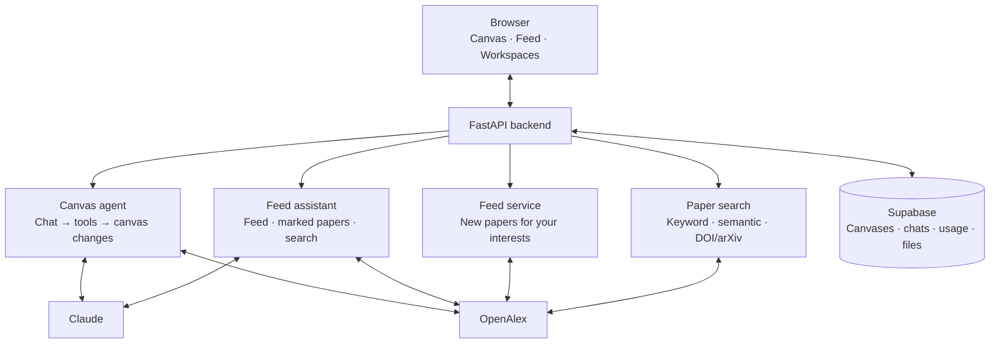

# Architecture

How Sediment fits together. To run it, see [development.md](development.md).

## The canvas

A canvas is a set of paper cards, notes and links, saved as one document. Papers can sit anywhere: in named clusters, linked to each other, or on their own. The browser applies every change, keeps undo history, and saves the canvas to the backend.

A new canvas starts empty. A search on the home page becomes the first message to the agent; marked feed papers start a canvas with those papers already on it.

## Canvas agent

Each message goes to Claude with the live canvas: its papers and their clusters and colours, the links, the notes, and the canvas's name and description. The agent works in a loop of up to 8 tool rounds, with a fixed spending cap per message and a shared daily cap.

| Tool | Purpose |
|---|---|
| `search_openalex_papers` | Find papers, or resolve a title, DOI or arXiv link |
| `get_openalex_references` | What a paper cites |
| `get_openalex_citing_papers` | Later work that cites a paper |
| `update_canvas_papers` | Add and remove papers, link them, put them in clusters |
| `update_canvas_details` | Name and describe the canvas |
| `read_timeline_notes`, `create_timeline_notes`, `update_timeline_notes` | Read and change notes |
| `read_timeline_node_colors`, `update_timeline_node_colors` | Read and set paper colours |
| `retrieve_graph_context` | Pull the relevant part of the canvas for a question |
| `web_search` | Anthropic's hosted web search |

Rules the server enforces, not just the prompt:

- Every paper the agent adds is looked up in OpenAlex first, so nothing invented reaches the canvas.
- After a canvas's first message, renaming or describing it needs the researcher's words asking for it.
- Changes stream to the browser as the agent works, and replies that arrive after the user switched canvas are ignored.

A canvas can have several chats. Each is stored with its messages; a rolling summary keeps long chats short.

The agent is told to label a link a citation (`influenced`) only when reference data shows one paper citing the other, and `inferred` otherwise. That rule is in its instructions; the server does not re-check each link.

Full-paper reading (fetching open-access PDFs, chunking, embedding with Voyage and searching passages) exists but is switched off for now (`full_paper_access_enabled`).

## Feed

The feed searches OpenAlex for recent papers matching your interests. Sources such as arXiv, Hugging Face, bioRxiv and medRxiv are OpenAlex searches filtered by where a paper was published. The feed picks a field from your interests and shows that field's sources:

| Field | Sources |
|---|---|
| AI | arXiv, Hugging Face, journals, OpenAlex |
| Bio and medicine | bioRxiv, medRxiv, journals, OpenAlex |
| Maths and physics | arXiv, journals, OpenAlex |
| General | repositories, journals, OpenAlex |

More detail: [feeds.md](feeds.md).

## Feed assistant

A separate, lighter agent on the feed. It sees the feed, the marked papers in full, and any papers tagged with `@`. It can search OpenAlex by relevance or by recency, show papers as cards, mark them, change your interests when you ask, search the web, and offer to start a workspace from a set of papers. Nothing is stored: the browser sends the conversation with each message.

## Code map

| Area | Where |
|---|---|
| Canvas agent routes and tools | [backend/app/routers/chat.py](../backend/app/routers/chat.py) |
| Agent prompts and loops | [backend/app/services/llm.py](../backend/app/services/llm.py) |
| Feed assistant | [backend/app/routers/feed_chat.py](../backend/app/routers/feed_chat.py) |
| Feed service and sources | [backend/app/services/feeds.py](../backend/app/services/feeds.py), [feed_sources/](../backend/app/services/feed_sources) |
| Paper search | [backend/app/routers/papers.py](../backend/app/routers/papers.py), [openalex.py](../backend/app/services/openalex.py) |
| Canvas edits and layout | [frontend/src/lib/timeline-actions.ts](../frontend/src/lib/timeline-actions.ts) |
| Canvas UI | [frontend/src/components/TimelineCanvas.tsx](../frontend/src/components/TimelineCanvas.tsx) |
| Agent panel | [frontend/src/components/GlobalChatPanel.tsx](../frontend/src/components/GlobalChatPanel.tsx) |

Diagrams of the earlier lineage-tracing pipeline and the full-paper ingestion flow are in [architecture-diagrams.md](architecture-diagrams.md).
